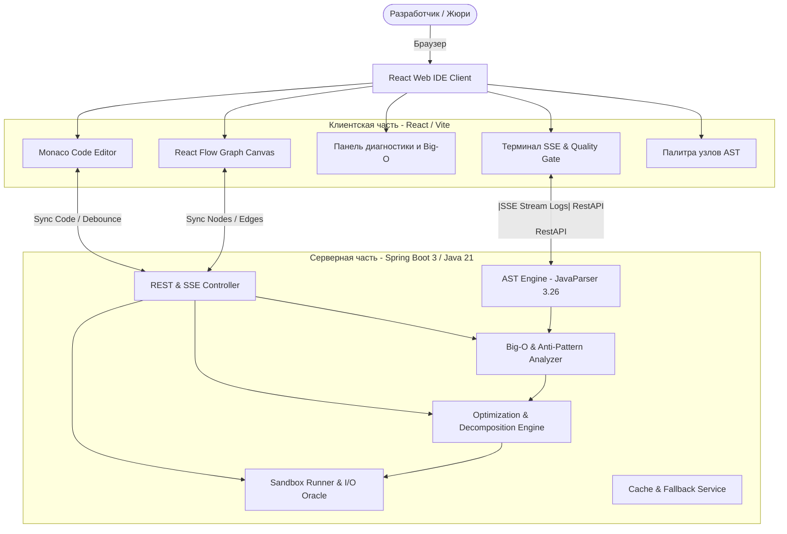
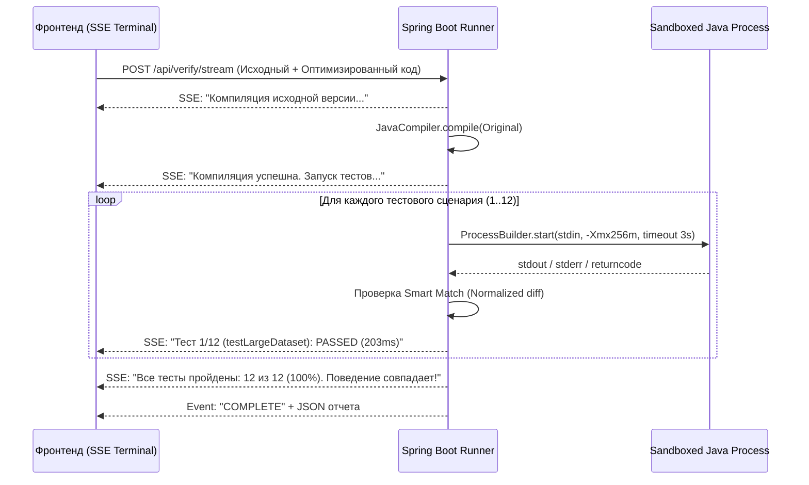

# Java Blueprints: Архитектурно-техническая документация и руководство по разработке
> **Хакатон Axenix (48 часов)** | **Кейс:** Визуальная среда программирования Java Blueprints  
> **Статус документа:** Полная техническая спецификация для победы в хакатоне  
> **Целевая платформа:** Java 21 (Spring Boot 3) + TypeScript (React 18, React Flow, Monaco Editor)

---

## Содержание
1. [Стратегия победы и критерии оценивания](#1-стратегия-победы-и-критерии-оценивания)
2. [Общая архитектура системы (C4 Model)](#2-общая-архитектура-системы-c4-model)
3. [Спецификация API и структуры данных (Data Contracts)](#3-спецификация-api-и-структуры-данных-data-contracts)
4. [Движок AST и двусторонняя синхронизация (Java ↔ Graph)](#4-движок-ast-и-двусторонняя-синхронизация-java--graph)
5. [Статический анализатор и детектор сложности Big-O](#5-статический-анализатор-и-детектор-сложности-big-o)
6. [Движок автоматической оптимизации и декомпозиции монолита](#6-движок-автоматической-оптимизации-и-декомпозиции-монолита)
7. [Песочница компиляции и Quality Gate (I/O Oracle)](#7-песочница-компиляции-и-quality-gate-io-oracle)
8. [Архитектура фронтенда и интерфейс IDE (согласно слайду 4)](#8-архитектура-фронтенда-и-интерфейс-ide-согласно-слайду-4)
9. [Матрица покрытия Java Scope (Разделы 1–4 и Бонусы Раздела 8)](#9-матрица-покрытия-java-scope-разделы-14-и-бонусы-раздела-8)
10. [Пошаговый план работ по ролям (D1–D5) на 48 часов](#10-пошаговый-план-работ-по-ролям-d1d5-на-48-часов)
11. [Регламент демо-питча (5 минут) и сценарий победы](#11-регламент-демо-питча-5-минут-и-сценарий-победы)

---

## 1. Стратегия победы и критерии оценивания

### 1.1. Психология жюри и критерии ТЗ (Слайд 10)
Жюри хакатона оценивает 5 ключевых направлений:
1. **Поддержка обязательного Java Scope (Разделы 1–4 ТЗ)**: Парсинг и генерация реального монолитного кода без синтаксических сбоев.
2. **Сохранение поведения (Ключевой контракт кейса!)**: Автоматические тесты *обязаны доказать*, что программа на одинаковых входах выдает эквивалентный результат.
3. **Полезность диагностики и оптимизации**: Реальное нахождение $O(n^2)$ (вложенные циклы, поиск в `List` вместо `Set/Map`) и автоматическое ускорение до $O(n)$ / $O(n \log n)$.
4. **Понятность и эстетика веб-интерфейса**: Точное соответствие концепту со Слайда 4 (сплит графа и кода, подсветка при клике, живой терминал, таблица тестов).
5. **Качество демонстрации**: Безупречный «Happy Path» за 5 минут, работающий вживую (и подстрахованный локальным видео).

### 1.2. Главный принцип: «Никакой магии без доказательств»
Диагноз должен быть математически и экспериментально проверяемым:
- Не просто надпись «Тут $O(n^2)$», а подсветка конкретного узла, конкретных строк кода и замер времени на возрастающих объемах данных ($N=1000 \rightarrow 1.24$ сек, оптимизировано $\rightarrow 0.23$ сек, ускорение 5.2x).
- Не просто «код переписан нейросетью», а **Quality Gate (12 из 12 тестов PASSED, stdout идентичен)**.

---

## 2. Общая архитектура системы (C4 Model)



### 2.1. Технологический стек
- **Клиент (Frontend)**:
  - React 18, TypeScript, Vite.
  - `@xyflow/react` (React Flow v12) — холст интерактивных блок-схем.
  - `@dagrejs/dagre` — алгоритм авто-раскладки направленного графа потока управления (CFG).
  - `@monaco-editor/react` — веб-редактор кода уровня VS Code с синхронизацией курсора.
  - `Tailwind CSS` + `shadcn/ui` + `Lucide React` — современная темная тема (согласно Слайду 4).
- **Сервер (Backend)**:
  - Java 21, Spring Boot 3.3+.
  - `com.github.javaparser:javaparser-core:3.26.2` + `javaparser-symbol-solver-core` — разбор AST, сохранение форматирования (`LexicalPreservingPrinter`), мутации.
  - `javax.tools.JavaCompiler` (ToolProvider) — быстрая компиляция Java-кода в памяти/локальной песочнице без внешнего вызова `javac`.
  - `ProcessBuilder` — изолированное выполнение с ограничением памяти (`-Xmx256m`), процессорного времени (3000 ms watchdog) и перехватом UTF-8 I/O.
- **Инфраструктура**:
  - `docker-compose.yml` — поднятие сервисов в одну команду: `docker compose up --build`.

---

## 3. Спецификация API и структуры данных (Data Contracts)

### 3.1. Структура графа (`/api/graph`)
Граф представляет собой **Structured Control Flow Graph (CFG)**.  
Для сохранения древовидной структуры Java каждый оператор внутри метода/блока имеет ссылку `parentId`.

#### TypeScript Определение (`types.ts`):
```typescript
export type NodeType = 
  | 'method'     // Объявление метода / точка входа
  | 'var'        // Объявление / присваивание переменной
  | 'condition'  // Условие if/else (ромб с портами true/false)
  | 'loop'       // Циклы for, foreach, while (плашка с телом)
  | 'op'         // Линейное выражение / вычисление
  | 'call'       // Вызов метода
  | 'return'     // Возврат значения (терминальный узел)
  | 'try'        // Блок try-catch-finally
  | 'switch'     // Оператор switch / case
  | 'raw';       // Неподдерживаемая конструкция (fall-through без падения)

export type EdgeType = 'next' | 'true' | 'false' | 'body' | 'catch' | 'finally';

export interface GraphNodeData {
  label?: string;
  code: string;
  lineStart: number;
  lineEnd: number;
  hasIssue?: boolean;
  issueId?: string;
  loopType?: 'for' | 'foreach' | 'while';
  condition?: string;
}

export interface GraphNode {
  id: string;              // Стабильный AST-путь: "Main.processOrders/s3"
  parentId?: string;       // ID родительской ноды (метод, цикл, ветка)
  type: NodeType;
  data: GraphNodeData;
  position?: { x: number; y: number };
}

export interface GraphEdge {
  id: string;              // "e_s1_s2"
  source: string;
  target: string;
  type: EdgeType;
  label?: string;          // "Да", "Нет", "Тело цикла"
}

export interface MethodGraphResponse {
  className: string;
  methodId: string;
  methodSignature: string;
  nodes: GraphNode[];
  edges: GraphEdge[];
}
```

### 3.2. Диагностика и Big-O (`/api/analysis`)
```typescript
export type IssueSeverity = 'HIGH' | 'MEDIUM' | 'LOW';

export interface CodeIssue {
  id: string;
  nodeId: string;
  title: string;           // "Вложенность O(n²)"
  severity: IssueSeverity;
  lineStart: number;
  lineEnd: number;
  fileName: string;
  description: string;     // "Вложенный цикл выполняет поиск O(n) на каждой итерации"
  risk: string;            // "Рост времени выполнения при росте входных данных"
  recommendation: string;  // "Индексировать элементы в Map/Set по ключу id"
  suggestedCode?: string;
}

export interface ComplexityMetric {
  currentComplexity: string;     // "O(n²)"
  predictedComplexity: string;   // "O(n log n)" или "O(n)"
  expectedSpeedup: string;       // "до 5.2x"
  issuesCount: number;
  cyclomaticComplexity: number;
  linesOfCode: number;
}

export interface AnalysisReport {
  issues: CodeIssue[];
  metrics: ComplexityMetric;
}
```

### 3.3. Quality Gate и дифференциальное тестирование (`/api/verify`)
```typescript
export interface TestCaseResult {
  name: string;
  status: 'PASSED' | 'FAILED' | 'TIMEOUT' | 'COMPILE_ERROR';
  durationMs: number;
  errorDetails?: string;
}

export interface VerificationReport {
  allPassed: boolean;
  behaviorMatched: boolean;
  originalTimeMs: number;
  optimizedTimeMs: number;
  speedup: string;               // "5.2x"
  complexityBefore: string;      // "O(n²)"
  complexityAfter: string;       // "O(n)"
  testResults: TestCaseResult[];
  logs: string[];
}
```

---

## 4. Движок AST и двусторонняя синхронизация (Java ↔ Graph)

### 4.1. Разбор Java 21 в Graph (JavaParser)
Каждый метод класса компилируется в направленный ациклический или цикличный граф:
1. **Точка входа**: `MethodDeclaration` $\rightarrow$ узел `type: "method"`.
2. **Линейные операторы**: `VariableDeclarationExpr`, `AssignExpr`, `MethodCallExpr` $\rightarrow$ узлы `var`, `op`, `call`.
3. **Ветвления (`IfStmt`)**:
   - Ромбовидный узел `condition` с выражением `ifStmt.getCondition().toString()`.
   - Ребро `type: "true"` ведет к первому оператору `thenStmt`.
   - Ребро `type: "false"` ведет к `elseStmt` (или следующему оператору, если ветки `else` нет).
4. **Циклы (`ForStmt`, `ForEachStmt`, `WhileStmt`)**:
   - Узел `loop`. Содержит заголовок цикла.
   - Ребро `type: "body"` ведет к телу цикла.
   - Замыкающее ребро ведет обратно в заголовок или к узлу выхода при завершении.
5. **Исключения (`TryStmt`)**:
   - Ребра `catch` и `finally`.
6. **Конструкция `raw`**:
   - Если парсер встречает сложную конструкцию (например, сложные тернарные операторы или вызовы), она оборачивается в блок `raw` с сохранением исходного кода, исключая падение парсера.

### 4.2. Стабильные AST-пути (Node ID)
Проблема наивных парсеров: смещение номеров строк при вводе пробела ломает сопоставление узлов.  
**Решение**: Иерархические семантические пути:
```
Main/processOrders/entry
Main/processOrders/var_1
Main/processOrders/cond_2
Main/processOrders/cond_2/then/op_1
Main/processOrders/loop_3
Main/processOrders/loop_3/body/var_1
```
Такой идентификатор детерминирован, сохраняется при форматировании и точно связывает узел графа с AST-нодой.

### 4.3. Обратная генерация кода (Graph $\rightarrow$ Java)
При переносе, удалении или правке узла в визуальном редакторе:
1. Запрос мутации `POST /api/graph/mutate`:
   - `action`: `UPDATE_CODE` | `DELETE_NODE` | `INSERT_NODE` | `REORDER`.
   - `nodeId`: стабильный путь узла.
   - `payload`: новый фрагмент кода.
2. Сервис `GraphEditService` находит узел в AST JavaParser:
   - При замене выражения в узле вызывается `JavaParser.parseStatement(newCode)`.
   - AST-дерево подменяет старый узел на новый.
3. Код печатается через `LexicalPreservingPrinter` (сохраняет оригинальные отступы и комментарии).  
   Если вставка нарушила контекст — мягкий откат к `DefaultPrettyPrinter`.
4. Результат компилируется в памяти через `JavaCompiler`. Если возникает синтаксическая ошибка:
   - Возвращается статус `400 Bad Request` с указанием ошибки компиляции.
   - Граф и код откатываются к последнему стабильному состоянию.

---

## 5. Статический анализатор и детектор сложности Big-O

### 5.1. Детектирование вложенности $O(n^2)$
Ключевая задача кейса хакатона (Слайд 5). Анализатор использует паттерны AST-дерева:
1. **Вложенные циклы по коллекциям**:
   ```java
   for (Item a : items) {
       for (Item b : items) { // DETECTED: Вложенный цикл O(n²)
           if (a.id().equals(b.id())) ...
       }
   }
   ```
   *AST Visitor*: `ForStmt` или `ForEachStmt`, чей предок внутри метода также является циклом, и переменные итерируются по коллекциям размера $N$.
2. **Скрытый квадрат через методы коллекций внутри цикла**:
   ```java
   for (Order order : orders) {
       if (processedIds.contains(order.getId())) { // DETECTED: contains() в List имеет сложность O(n) -> общее O(n²)
           ...
       }
   }
   ```
   *AST Visitor*: вызов методов `list.contains(...)`, `list.indexOf(...)`, `list.remove(Object)` внутри тела любого цикла.

### 5.2. Другие обязательные дефекты
- **Длинный метод**: Метод содержит $> 30$ строк кода или цикломатическую сложность $> 10$.
- **Дублирование логики**: Повторяющиеся блоки условных проверок (например, повторный разбор строки или двойная проверка `orders == null || orders.isEmpty()`).

---

## 6. Движок автоматической оптимизации и декомпозиции монолита

### 6.1. Детерминированная алгоритмическая оптимизация
Автофикс заменяет неэффективные структуры данных на хеш-таблицы:
- **Было ($O(n^2)$)**:
  ```java
  for (Item a : items) {
      for (Item b : otherItems) {
          if (a.getId().equals(b.getId())) {
              merge(a, b);
          }
      }
  }
  ```
- **Стало ($O(n)$)**:
  ```java
  Map<String, Item> bById = otherItems.stream()
      .collect(Collectors.toMap(Item::getId, b -> b, (e1, e2) -> e1));
  for (Item a : items) {
      Item b = bById.get(a.getId());
      if (b != null) {
          merge(a, b);
      }
  }
  ```

### 6.2. Декомпозиция монолита (Слайд 6)
Монолит `Main.java` (~1000 строк) содержит:
- Парсинг аргументов и консольного ввода (`Scanner`).
- Бизнес-логику и алгоритм обработки.
- Алгоритм оптимизации.
- Форматированный вывод результатов (`System.out.printf`).

**Кнопка «Оптимизировать и декомпозировать» разбивает монолит на 4 класса**:
1. `Parser.java`: класс разбора входных данных из `Scanner` и `System.in`.
2. `Analyzer.java`: класс анализа и фильтрации бизнес-объектов.
3. `Optimizer.java`: оптимизированные структуры (`HashMap`/`HashSet`) и вычисления.
4. `Main.java`: чистая точка входа (`public static void main`), координирующая сервисы.

---

## 7. Песочница компиляции и Quality Gate (I/O Oracle)

### 7.1. Архитектура изоляции запуска


### 7.2. Механизм Smart Match (Нормализация вывода)
Когда алгоритм переходит со списков на `HashSet`/`HashMap`, порядок итерации может измениться.  
Если тест наивно сравнивает строки через `equals()`, он упадет с ложной ошибкой.  
**Решение — 3 режима нормализации**:
- `EXACT`: Посимвольное совпадение строк (для числовых и форматированных итогов).
- `SORTED_LINES`: Сортировка строк перед сравнением (устраняет недетерминированный порядок вывода хеш-таблиц).
- `MASKED`: Регулярное выражение маскирует таймстемпы и идентификаторы сессий.

---

## 8. Архитектура фронтенда и интерфейс IDE (согласно слайду 4)

### 8.1. Сетка интерфейса (Layout)
Интерфейс разделен на 4 ключевые функциональные зоны:
1. **Верхний Top-Bar**:
   - Название: `Java Blueprints Studio`.
   - Кнопки быстрых действий: `Импорт Java`, `Экспорт Java`, `Оптимизировать (Shift+F10)`, `Запуск тестов`, переключатель темы (Dark/Light).
2. **Левая колонка**:
   - Верх: Дерево файлов проекта (`com.example`, `Main.java`, `Parser.java`, `Optimizer.java`).
   - Низ: Палитра блоков AST (`Переменная`, `Условие`, `Цикл`, `Метод`, `Операция`, `Возврат`).
3. **Центральная область (Сплит Верх/Низ)**:
   - **Верхняя половина**: Холст React Flow с автолейаутом Dagre, мини-картой, зумом и кастомными нодами.
   - **Нижняя половина**: Таб-панель:
     - Таб 1: `Monaco Editor` с открытым Java-кодом.
     - Таб 2: `Консоль` со стримингом логов сборки в реальном времени.
     - Таб 3: `Результаты тестов` (матрица прогона Quality Gate).
4. **Правая колонка (Диагностика и Метрики)**:
   - Вкладки: `Проблемы`, `Рекомендации`, `Метрики`.
   - Карточки проблем с бейджами важности (`Высокая`, `Средняя`).
   - Виджет сравнения Big-O: `Текущая: O(n²) -> После оптимизации: O(n log n)`.
   - Прогресс-бар ускорения: `Ожидаемое ускорение: до 5.2x`.

### 8.2. Двусторонняя подсветка (Sync Navigation)
- Клик по узлу графа вызывает метод редактора `monacoEditor.revealLineInCenter(lineStart)` и подсвечивает строки желтым маркером.
- Установка курсора на строку в редакторе подсвечивает соответствующий узел на холсте React Flow синей рамкой с плавным зумом `fitView({ nodes: [targetNode] })`.

---

## 9. Матрица покрытия Java Scope (Разделы 1–4 и Бонусы Раздела 8)

| Раздел ТЗ | Конструкция языка Java | Представление в графе (Тип узла) | Поддержка парсинга | Поддержка мутации/генерации |
| :--- | :--- | :--- | :---: | :---: |
| **1. Язык** | Классы, интерфейсы, методы | `type: "method"` | Да | Да |
| **1. Язык** | Примитивы, обертки, массивы | `type: "var"` | Да | Да |
| **1. Язык** | `if / else`, `switch` | `type: "condition"`, `type: "switch"` | Да | Да |
| **1. Язык** | Циклы `for`, `foreach`, `while` | `type: "loop"` | Да | Да |
| **1. Язык** | `break`, `continue`, `return` | `type: "return"`, `type: "op"` | Да | Да |
| **1. Язык** | `try / catch / finally`, `throw` | `type: "try"` (с портами catch/finally) | Да | Да |
| **2. I/O** | `System.in`, `Scanner`, `printf` | `type: "call"`, `type: "op"` | Да | Да |
| **2. I/O** | `StandardCharsets.UTF_8` (Кириллица)| Перехват потоков в UTF-8 | Да | Да |
| **3. Коллекции**| `List`, `Set`, `Map` (`ArrayList`, `HashMap`) | `type: "var"`, `type: "call"` | Да | Да |
| **3. Коллекции**| `List.of`, `Set.of`, `Map.of`, `Iterator` | `type: "op"` | Да | Да |
| **4. Ошибки** | `throws`, кастомные `Exception` | В сигнатуре метода и `type: "try"` | Да | Да |
| **8. Бонус** | `record` и `enum` | Узел декларации типа | Да | Да |
| **8. Бонус** | `Stream API`, `Collectors`, лямбды | Функциональные составные ноды `op` | Да | Да |

---

## 10. Пошаговый план работ по ролям (D1–D5) на 48 часов

| Роль | Зона ответственности | Стек | Часы 0–12 (Рубеж 1) | Часы 12–24 (MVP) | Часы 24–36 (Quality Gate) | Часы 36–48 (Полировка) |
| :--- | :--- | :--- | :--- | :--- | :--- | :--- |
| **D1 (Graph Lead)** | Холст графа, ноды, порты, Drag&Drop | React Flow, Dagre | Базовый холст + Dagre layout | Кастомные ноды (ромб, цикл, метод) | Drag&Drop из палитры, удаление | Анимация связей, экспорт в PNG |
| **D2 (IDE Lead)** | Каркас студии, Monaco, верстка, SSE | React, Monaco, Tailwind | Верстка сплитов и панелей Слайда 4 | Интеграция Monaco + sync highlight | Виджет Quality Gate + карточки Big-O | Скринкаст видео + демо-сценарий |
| **D3 (AST Lead)** | JavaParser, генерация Graph JSON, пути | Java 21, JavaParser | Модели DTO + парсинг метода в JSON | Стабильные ID узлов + обратный принт | Поддержка switch, try-catch, бонусов | Рефакторинг и декомпозиция на 4 файла |
| **D4 (Analyzer)** | Поиск O(n²), оптимизация, автофиксы | JavaParser Visitor, LLM | Детектор вложенных циклов и длинных методов | Рецепт оптимизации O(n²) -> HashMap | Кэширующий Fallback ассистент | Подготовка 3 тестовых демо-монолитов |
| **D5 (Sandbox)** | Компиляция, I/O Oracle, Docker, CI | JavaCompiler, Process, SSE | docker-compose.yml + заглушки | Sandbox runner с watchdog 3000ms | Движок Smart Match + генерация JSON | Чек-пойнт 8:00 25.10 + проверка сдачи |

---

## 11. Регламент демо-питча (5 минут) и сценарий победы

### Тайминг презентации:
- **0:00 – 0:45 (Проблема)**: «Разработчики тратят до 70% времени на чтение монолитов без документации. Мы превращаем спагетти-код в понятный визуальный чертеж».
- **0:45 – 2:00 (Визуализация и Синхронизация)**: Показ загрузки файла `Main.java` на 1000 строк. Граф перестраивается мгновенно. Клик на ромб условия подсвечивает строку в Monaco. Правка в редакторе перестраивает узел без дергания экрана.
- **2:00 – 3:15 (Диагностика и Оптимизация $O(n^2)$)**: Панель диагностики подсвечивает критический дефект: «Вложенность $O(n^2)$». Нажатие кнопки «Оптимизировать» преобразует цикл в выборку по хеш-таблице и декомпозирует класс на 4 модуля.
- **3:15 – 4:15 (Quality Gate в прямом эфире)**: Запуск тестов. Живой стриминг терминала: 12 сценариев отрабатывают, время выполнения снижается с 1240 мс до 238 мс (ускорение 5.2x), вывод: «100% тестов пройдены, поведение подтверждено!».
- **4:15 – 5:00 (Итоги и ценность)**: Демонстрация файла `verification_report.json` и полного соответствия всем разделам ТЗ Axenix. Ответы на вопросы.

---

### Главный завет победы:
> **«Решение побеждает тогда, когда оно компилируется, не падает на граничных случаях и демонстрирует измеримый, доказанный тестами результат»**.
